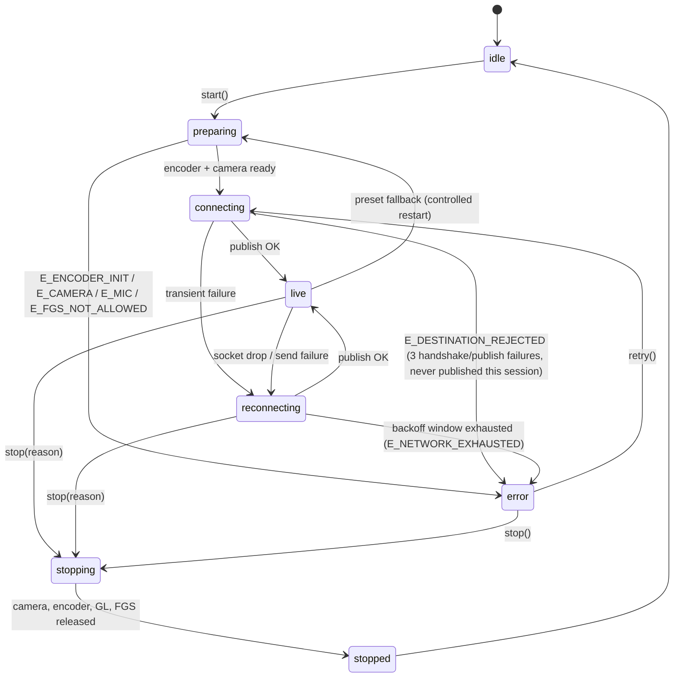
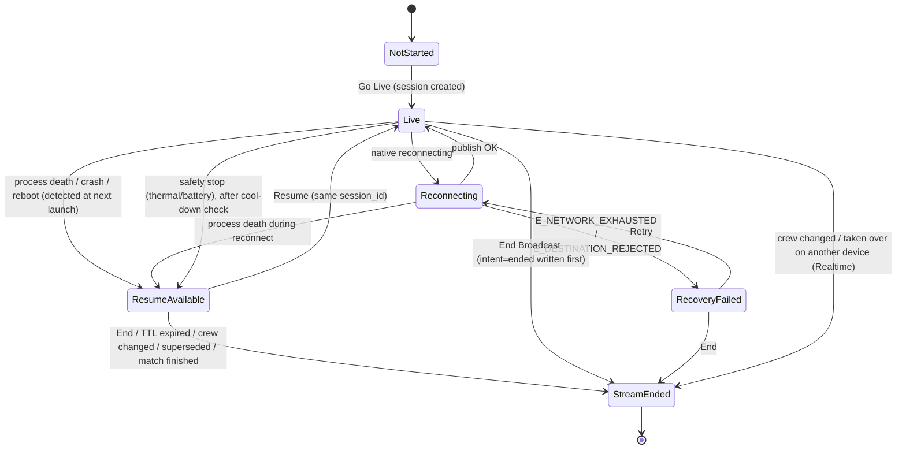

# Live broadcast: in-app camera stream to YouTube / Facebook with live score graphics

**Status: PLAN v3.1. Phase 0 is authorized and being implemented. Phases 1–4 are NOT authorized.** No
migrations, production UI or paid-pack work. Every number marked *(target)* is a provisional Phase 0
threshold. None of them is a measured result or a hardware guarantee.

v3.1 refinements:
- **Two separate heartbeats** (§8.6):
  - The JS heartbeat reports UI health.
  - A native heartbeat reports what the stream is actually doing. It is authenticated with a secret that
    belongs to that one session.
  
  A frozen JS thread therefore never marks a running stream as interrupted.
- **Race-safe takeover**, using a compare-and-swap on the session id. Server-side revocation **cannot**
  invalidate a stream key that another device already holds (§8.7, §8.9).
- **Per-platform bitrate floors** taken from current YouTube and Facebook guidance. Running below a
  platform minimum is reported as **degraded**, not as an error (§3.2).
- **Battery drain thresholds are measured targets.** A failure on one device triggers investigation of
  that device. It does not reject the architecture.
- **Separate tests** for Activity recreation, JS crash, native crash, process kill, swipe-away and
  force-stop (§10).
- **Recovering an esSports session never implies the same YouTube or Facebook live event** (§8.8).

Confirmed decisions:
- Only the owner assigns the streamer.
- Eligible streamers are squad players and team staff.
- In friendly matches, the creator assigns.
- `RESUME_TTL` is 30 min initially.
- Remember Key is on by default, with an opt-out and a way to clear the saved key.
- The thresholds are provisional.

Changes from v2:
- the split between Kotlin and React Native is now explicit
- device eligibility and quality presets
- the native API and state machine
- network recovery and adaptive bitrate (ABR)
- thermal handling
- **broadcast session persistence and recovery** (§8)
- a measurable Phase 0
- the streamer rule (assigned by the tournament owner to a match participant)

---

## 1. Requirements (agreed)

| # | Requirement |
|---|---|
| R1 | The **tournament owner** assigns the **streamer**, who must be someone taking part in the match. Tournament staff still pick the **scorer** at fixture start, as they do today. |
| R2 | The streamer streams from the **esSports app camera** to **YouTube or Facebook**, one platform per broadcast. |
| R3 | Graphics are burned into the video: the scorebug plus one panel at a time. **Only the streamer** controls them. |
| R4 | The scorer's balls reach the streamer through Supabase Realtime, and the graphics update automatically. |
| R5 | The streamer pastes the RTMP(S) server URL and stream key. There is no Google or Meta sign-in. |
| R6 | Android only. Expo managed workflow with a local native module and a config plugin. Dev build required. |
| R7 | Streaming needs at least 4 GB of physical RAM **and** passing encoder, camera and mic checks. Ineligible devices can still score and watch. |
| R8 | 720p30 by default. 1080p30 is optional and needs hardware capability. Resolution changes use a controlled restart. |
| R9 | RTMPS is **mandatory for Facebook** and the **default for YouTube**. |
| R10 | Kotlin owns the stream lifecycle, reconnect, ABR and recovery, independent of the JS thread. |
| R11 | React Native renders the graphics (Option A, bitmap snapshot). Native keeps the last valid bitmap if JS stalls. |
| R12 | The broadcast session survives disconnects, backgrounding and process death, with an explicit Resume (§8). |
| R13 | Graphics run on the `GraphicTheme` system so paid packs can be added later. No coins or store in this phase. |
| R14 | No new backend infrastructure. Supabase (Postgres, RLS, RPC, Realtime) only. |

### Confirmed (2026-11-03)
- Moderators **cannot** assign the streamer. Only the owner can.
- "Participating" means a registered squad player (XI or bench) or `staff` member of either playing team.
- For a friendly match, the match creator assigns the streamer from the match's players.

---

## 2. Architecture

```
 Scorer phone (existing)            Supabase                      Streamer phone
 ─────────────────────             ──────────                    ─────────────────────────────────────────
 append_ball_event ───────────▶  ball_events  ──Realtime──▶  React Native (JS)
                                 matches                       ├ loadLiveMatch / buildLiveView (existing)
                                 match_broadcasts ◀──RPC───────┤ GraphicTheme renderer → <OverlayHost>
                                 broadcast_sessions ◀─RPC──────┤ Streamer Console UI, session file, SecureStore
                                                               │        │ captureOverlay() (main thread)
                                                               ▼        ▼
                                                             Kotlin: LiveStreamService (foreground service)
                                                               ├ RootEncoder: camera → GL → H.264 / AAC
                                                               ├ overlay filter (last valid bitmap)
                                                               ├ state machine, reconnect, ABR, preset fallback
                                                               └ thermal, battery, stats ──RTMPS──▶ YouTube / Facebook
```

### Who owns what

| Kotlin (`modules/live-stream`) | React Native |
|---|---|
| Camera, H.264 hardware encoder, AAC, RTMP/RTMPS push (RootEncoder) | Every screen: setup, console, recovery prompts |
| **Stream state machine, reconnect backoff, ABR, 1080p→720p fallback** | Realtime sync, `buildLiveView`, GraphicTheme rendering |
| Foreground service, wake lock, thermal and battery listeners | Deciding *when* to capture: coalesce updates, capture only after a change |
| Eligibility preflight: RAM, MediaCodec, permissions | Session descriptor file, SecureStore read and write |
| `OverlayHost` view capture into a **reused** bitmap, then the GL texture; keeps the last valid one | Calling the session RPCs (heartbeat, end) |
| Removing secrets from every string that crosses to JS | Mapping native states to the four user-facing recovery states |

**Why heartbeats come from JS and not from native:** if native sent them, the Supabase auth token would have
to live in the Kotlin process. Sending them from JS keeps the native side free of credentials. The cost is
small: if JS freezes, heartbeats stop and spectators see "interrupted" after a timeout (§8.6), while the
video keeps playing.

### Dependencies

| Add | Why it is needed |
|---|---|
| **RootEncoder** (Gradle, JitPack, Apache-2.0), pinned version | Camera, encoding, RTMPS and GL filters. Nothing already in the app does this. |

**Not adding:**
- `react-native-view-shot`: our own native `OverlayHost` captures directly into a reused bitmap with no
  base64 or file round-trip
- AsyncStorage: `expo-file-system` is already installed
- `expo-keep-awake`: the service holds a wake lock
- an orientation library: react-native-screens has `orientation`
- a crash tracker
- a streaming server

### Config plugin (`modules/live-stream/plugin`)
- **Permissions:** `CAMERA`, `RECORD_AUDIO`, `FOREGROUND_SERVICE`, `FOREGROUND_SERVICE_CAMERA`,
  `FOREGROUND_SERVICE_MICROPHONE`, `POST_NOTIFICATIONS`, `WAKE_LOCK`.
- **Service declaration:**
  `<service android:name=".LiveStreamService" android:foregroundServiceType="camera|microphone"
  android:exported="false" android:stopWithTask="false"/>`.
- The JitPack repository goes into the Gradle settings.
- **Play Console:** the camera and microphone foreground-service types must be declared, with a
  justification and a demo video. This is a release-blocking task.

---

## 3. Device eligibility and quality presets

### 3.1 Eligibility (all checks must pass, run natively in `getDeviceEligibility()`)

| Check | Method | Rule |
|---|---|---|
| RAM | API 34 and later: `MemoryInfo.advertisedMem`. Older: `MemoryInfo.totalMem` | Advertised ≥ 4 GB, **or** totalMem ≥ **3.3 GiB** (a marketed 4 GB phone reports about 3.5–3.8 GiB). The threshold is tuned in Phase 0. |
| Hardware H.264 encoder | `MediaCodecList`. API 29 and later: `isHardwareAccelerated`. Older: reject `OMX.google.*` and `c2.android.*` | At least one HW `video/avc` encoder |
| 720p30 | `VideoCapabilities.areSizeAndRateSupported(1280,720,30)` plus the bitrate range | Required |
| 1080p30 | Same check at 1920×1080 at 30. API 29 and later: also `getSupportedPerformancePoints` | Only enables the 1080p *option* |
| Camera and mic | Runtime permissions, plus actually opening the back camera at the chosen size | Required |
| Thermal | `getCurrentThermalStatus` (API 29+) | Blocks Go Live at `SEVERE` or above. Shows "unknown" below API 29 and does not block. |
| Battery | `BatteryManager` | Blocks below 10% when not charging. Warns below 20%. |

An ineligible device shows the reason, for example "This phone has less than 4 GB RAM" or "No hardware
video encoder". The scorer, spectator and watch-live screens are unaffected.

### 3.2 Presets

**Platform ingest guidance, checked 2026-11-03:**
- **YouTube** (support.google.com/youtube/answer/2853702), H.264:
  - 720p30: minimum **3 Mbps**, recommended 8 Mbps
  - 1080p30: minimum **5 Mbps**, recommended 14 Mbps
  - keyframe 2 s (never more than 4 s), audio AAC 44.1 kHz stereo at 128 kbps, RTMPS recommended
- **Facebook** (Live Video API reference):
  - 720p30: **1.5–4 Mbps**
  - 1080p30: **3–6 Mbps**
  - keyframe 2 s (never more than 4 s), AAC-LC stereo at 44.1 or 48 kHz, 128–256 kbps, RTMPS required

The YouTube "recommended" rates (8 and 14 Mbps) are above what mobile upload at a ground can reliably
sustain. The presets therefore target each platform's minimum-to-moderate range, and a lower bitrate is
treated as a degraded mode rather than a failure.

| Preset × platform | Start | Ceiling | **Nominal floor** (platform minimum) | Hard floor (degraded zone) |
|---|---|---|---|---|
| 720p30 · YouTube (default) | 3.0 Mbps | 4.5 Mbps | 3.0 Mbps | 1.5 Mbps |
| 720p30 · Facebook (default) | 3.0 Mbps | 4.0 Mbps | 1.5 Mbps | 1.0 Mbps |
| 1080p30 · YouTube (opt-in) | 5.0 Mbps | 6.0 Mbps | 5.0 Mbps | 3.5 Mbps |
| 1080p30 · Facebook (opt-in) | 4.5 Mbps | 6.0 Mbps | 3.0 Mbps | 2.5 Mbps |

All presets share these settings:
- H.264 hardware encoder, profile High if supported, otherwise Main
- 30 fps, keyframe interval 2 s
- AAC 128 kbps at 44.1 kHz stereo
- RTMPS for Facebook, and for YouTube by default

- **Degraded mode:** ABR may go below the nominal floor, down to the hard floor, to keep the stream up.
  - Native reports `quality: 'degraded'` in its stats, and the console shows "Below YouTube's
    recommended minimum: viewers may see lower quality".
  - At 1080p, being degraded for a sustained period triggers the 720p fallback (§3.3).
- **Starting at the floor and ramping up** stands in for an upload speed test, because there is no
  server to test against. `NetworkCapabilities.getLinkUpstreamBandwidthKbps` is advisory only.
  - It warns when the reported upload is below 1.5× the start bitrate.
  - It never blocks the stream.
- Phase 0 confirms these values against visual quality on each platform, and against how YouTube Studio
  and Facebook health panels warn about bitrate.

### 3.3 Controlled fallback from 1080p to 720p
- **Trigger, evaluated natively:** either of these for 45 seconds or more *(target)* while live:
  - the bitrate is below the nominal 1080p floor (degraded) while the send queue is congested
  - effective FPS is below 25
  
  Thermal status at `SEVERE` or above also triggers it immediately.
- **Action:**
  1. emit `onPresetFallback`
  2. stop the encoder, keeping the RTMP session intent
  3. re-prepare at 720p
  4. reconnect to the same destination
  5. the UI shows "Switched to 720p to keep the stream stable"
- Going back up to 1080p mid-stream never happens automatically. The streamer has to restart the stream
  manually.

---

## 4. Native module API (`modules/live-stream`, Expo Modules API, Kotlin)

```ts
type Preset = '720p30' | '1080p30';
type NativeState = 'idle' | 'preparing' | 'connecting' | 'live' | 'reconnecting' | 'stopping' | 'stopped' | 'error';
type StopReason = 'user' | 'crew_change' | 'superseded' | 'match_completed' | 'thermal' | 'battery' | 'fatal';
type ErrorCode = 'E_PERMISSION' | 'E_CAMERA' | 'E_MIC' | 'E_ENCODER_INIT' | 'E_FGS_NOT_ALLOWED'
  | 'E_DESTINATION_REJECTED' | 'E_NETWORK_EXHAUSTED' | 'E_THERMAL_CRITICAL' | 'E_BATTERY_CRITICAL' | 'E_UNKNOWN';

getDeviceEligibility(): Promise<Eligibility>          // §3.1; presets: { '720p30': {ok, reason}, '1080p30': {ok, reason} }
getStatus(): Status                                    // sync; reattach after the UI is recreated
//   { state, sessionId | null, preset, platform, bitrateKbps, fps, droppedFrames, queueMs,
//     reconnectAttempt, overlayAgeMs, thermal, lastError: {code, fatal} | null }
start(opts: { sessionId: string; platform: 'youtube' | 'facebook'; url: string; key: string;
              preset: Preset }): Promise<void>         // key is held in memory only, never persisted or logged
stop(reason: StopReason): Promise<void>                // idempotent
retry(): Promise<void>                                 // from error(E_NETWORK_EXHAUSTED); same session, fresh backoff
setOverlayEnabled(enabled: boolean): void

<CameraPreviewView style />                            // native preview surface bound to the service
<OverlayHost ref width={1280|1920} height={720|1080}>  // React Native graphics live inside it
  overlayHostRef.capture(): Promise<{ capturedAt: number; ms: number }>
//   draws the view into a reused ARGB bitmap on the main thread, then hands it to the GL thread.
//   On failure the previous bitmap stays on air.

// Phase 1 adds: start({ ..., heartbeat: { endpoint, publishableKey, secret } }) for the native heartbeat (§8.6).
events: onStateChange({ state, previous, reason?, sessionId })
        onStats({ fps, bitrateKbps, droppedFrames, queueMs, quality: 'normal' | 'degraded', uploadKbps? })   // every 2 s
        onError({ code, fatal, message })              // message has URL and key text stripped natively
        onPresetFallback({ from, to, reason })
        onThermal({ status })
```

**Secret hygiene, enforced natively:**
- The URL and key are never written to SharedPreferences, files or Logcat.
- RootEncoder logging is turned off in release builds. Phase 0 checks that the library does not log the
  URL.
- Every error string passes through `redact()`, which removes `rtmp(s)://…` and anything key-shaped,
  before it is emitted.
- The foreground notification shows "Live on YouTube · Match 4" only.

### 4.1 Native stream state machine



`live` and `reconnecting` both move to `stopping` on a critical thermal or battery alert, with the reason
set to `thermal` or `battery`.

---

## 5. Network recovery and adaptive bitrate (native)

- **Reconnect backoff:** 1, 2, 4, 8, 16, then 30 s capped, with ±20% jitter.
  - The **total window is 5 minutes** *(target)*.
  - After that the state becomes `error(E_NETWORK_EXHAUSTED)` and the UI shows **Recovery Failed**, with
    Retry and End buttons.
  - Native never loops without a bound.
- **Network-aware:** `ConnectivityManager.NetworkCallback.onAvailable` skips the remaining wait and
  reconnects at once. While no network exists, attempts are paused rather than burned, though the window
  timer keeps running.
- **Bounded buffering:** while reconnecting, encoded frames are **dropped, not queued**, and the send
  queue is capped at about 2 s of video. When the connection resumes, it starts on the next keyframe
  (forced). Memory stays flat during long outages.
- **Telling a rejected key from a bad network:** RTMP servers rarely give a clear auth error. The heuristic:
  - 3 consecutive handshake or publish failures *before any successful publish in this session* count as
    `E_DESTINATION_REJECTED`, which is fatal: check the stream key or URL, and no retry loop runs.
  - Failures *after* a successful publish count as network trouble and go into backoff.
  - Phase 0 verifies this against real invalid and expired keys on both platforms.
- **ABR:** this uses RootEncoder's bitrate adapter and its `onNewBitrate` and queue callbacks. The exact
  class names are checked against the pinned version in Phase 0.
  - **Decrease:** down 15% per 2 s window while the queue grows or dropped frames rise.
  - **Increase:** up 5% per 10 s, and only after 20 s of stable queue.
  - The bitrate is clamped to the preset's range.
- **Stats** come out every 2 s for the console and are written to the Phase 0 CSV log.

---

## 6. Graphics pipeline and performance (React Native renders, native composites)

1. Realtime ping, then React Query refresh. The existing settle delay of 400 ms coalesces bursts of balls.
2. `buildLiveView` produces the GraphicTheme renderer's output inside `<OverlayHost>`, which is laid out at
   the stream resolution and placed off-screen. The console shows a scaled preview.
3. **When to capture:**
   - only when the *rendered inputs* change: score, crease, panel, theme or flash step
   - at most one capture per **250 ms**, and the latest state always wins
   - after layout has committed (two animation frames later)
4. Native draws into **one reused bitmap**. The GL thread updates the existing texture, so nothing is
   re-allocated per update. A failed capture leaves the previous bitmap on air.
5. **Flashes** (FOUR, SIX, WICKET, 50, 100, result) are **stepped, not tweened**: three captures each for
   enter, hold and exit, about 1.5 s in total. Flashes are switched off automatically at thermal
   `MODERATE` or above.
6. **The scorebug is never optional.** Panels and flashes can be turned off.
7. **JS freeze:** native keeps compositing the last bitmap, and `overlayAgeMs` grows. When JS recovers,
   the overlay is recaptured from *fresh* data (§8.5).
8. **Cleanup:** the bitmap is recycled and the GL texture deleted on `stopped`. Leak checks are part of
   Phase 0 (G4).

**Main Phase 0 risk:** whether `View.draw()` of an off-screen Fabric hierarchy that includes
react-native-svg renders correctly and in less than 16 ms on the main thread. If it does not, the
fallback is to keep `OverlayHost` visible behind the preview at the stream size. Option B, native drawing,
stays rejected because it would mean building every graphic pack twice.

## 7. Thermal and battery policy

| Condition | Action |
|---|---|
| Thermal `MODERATE` | Flashes and panel animations off. A warning chip appears. |
| Thermal `SEVERE` | A warning. The ABR ceiling drops by 25%. 1080p falls back to 720p (§3.3). |
| Thermal `CRITICAL` and above | **Safety stop**, reason `thermal`. Resume is offered after cool-down (§8). |
| Battery below 15% and not charging | A warning: "Connect a charger". |
| Battery below 5% and not charging | Safety stop, reason `battery`. Resume is offered. |
| Below API 29 (no thermal API) | Battery temperature (`EXTRA_TEMPERATURE`) at 45 °C or above triggers a warning only. |

---

## 8. Broadcast session persistence and recovery

### 8.1 What a session is
- A **broadcast session** is identified by `(match_id, session_id)`. The `session_id` is a client-generated
  UUID, created at the first Go Live.
- A session lasts until it is **deliberately ended** (End Broadcast, crew change, or takeover by another
  device) or until it **expires** (§8.6).
- Reconnects, preset fallback, backgrounding and Resume after process death all **keep the same
  `session_id`**.

### 8.2 Where state lives

| Data | Where | Secret? |
|---|---|---|
| RTMP(S) server URL **and** key, stored as one destination: `{url, key}` | `expo-secure-store` (Android Keystore), key `broadcast.dest.<platform>` | **Yes.** The whole URL is treated as secret, because Facebook URLs and keys can include query tokens. |
| Session descriptor `{v, matchId, sessionId, platform, destHost, preset, packId, graphic, flashes, watchUrl, intent, nativeState, updatedAt}` | `expo-file-system`: `documentDirectory/broadcast/session.json`, written atomically (write a temp file, then rename) | No |
| Live stream state | Kotlin service memory only. **Nothing native is persisted.** | n/a |
| Authoritative session and display | Supabase: `broadcast_sessions` and `match_broadcasts` (§8.7) | No |

- `intent` is `live` or `ended`. It is written **before** any intentional stop. It is how the app tells a
  deliberate end from an accident.
- A **"Remember stream key"** toggle defaults to on, because YouTube and Facebook persistent keys are
  reused. When it is off, the destination is deleted on End Broadcast.

### 8.3 Lifecycle rules
1. **Backgrounding the UI or closing the console screen does not stop the stream.**
   - The foreground service with types `camera|microphone` keeps it running, and `stopWithTask=false`.
   - Only End Broadcast, a crew change, a takeover or a safety stop end it.
2. **The foreground service only starts while the app is visible**, because Android 14 and later restrict
   camera and microphone use from the background. As a result, **process death is never auto-restarted**:
   the service returns `START_NOT_STICKY`. Recovery always goes through the user's **Resume Broadcast**
   tap.
3. **If Android kills the process, or the user swipes it away on an OEM build that kills services, the
   stream has stopped.** The app never claims otherwise. The platform shows the broadcast as ended or
   waiting.
4. **When the UI is recreated while the service is still alive**, for example after activity recreation or
   reopening from the notification:
   - `getStatus()` returns the live session
   - React Native reattaches the console and recaptures the overlay from fresh data
   - no prompt appears

### 8.4 What happens at app launch and when the console opens

```
read session.json
 ├─ missing, or intent = ended                              → nothing to recover
 ├─ native getStatus().sessionId == file.sessionId           → reattach (stream still running)
 └─ native idle and intent = live                            → candidate for "Resume Available"
      validate (server RPC get_broadcast_resume):
        • caller is still the assigned streamer               else → "Stream Ended" (crew changed), clear file
        • server session_id == file.sessionId, not ended      else → "Stream Ended" (ended/superseded elsewhere)
        • match not completed / abandoned                     else → "Stream Ended" (match finished)
        • session younger than RESUME_TTL (30 min, target)    else → expired, clear file
        • SecureStore destination present                     else → Resume asks to re-enter key
      → show "Resume Available" card (platform, preset, last live time) [Resume] [End broadcast]
```

### 8.5 How Resume works
1. Restore the platform, destination (from SecureStore), preset, pack, graphic and watch URL from the file.
2. Run **preflight again** (§3.1). If a 1080p preset now fails it, offer 720p.
3. **Graphics come from the server, never from a saved bitmap:**
   - first refetch `loadLiveMatch` (authoritative ball events), then render and `capture()`
   - if no data arrives within 5 s, go live with the overlay disabled and the banner "Graphics will
     appear when the score loads"
   - an old score is never shown
4. `start({ sessionId: same, ... })`. Then `resume_broadcast_session` on the server.
5. **Watch URL check:** after a gap, YouTube or Facebook may have started a *new* video (§8.8). The UI
   asks: "Is your watch link still the same?" It offers to paste a new one, defaulting to "same" for gaps
   under 60 s.

### 8.6 Recovery state diagram (user-facing session states)



UI copy:
- **Reconnecting** "Reconnecting… attempt 3 · video is paused for viewers"
- **Resume Available** "Your broadcast stopped unexpectedly · Resume"
- **Stream Ended** shows the reason
- **Recovery Failed** shows the cause (network or key) with Retry and End

**There are two heartbeats, and they mean different things:**
- **Native heartbeat** (the source of truth for whether the stream is on air):
  - The Kotlin service sends it every 20 s and on every native state change, with
    `{session_id, native_state, bitrate_kbps}`.
  - It calls one narrow RPC, `native_broadcast_heartbeat`, over HTTPS.
  - It authenticates with a **per-session heartbeat secret**. `start_broadcast_session` returns a random
    32-byte secret, and the server stores only its SHA-256 hash.
  - The secret can update the heartbeat of that one session and nothing else.
  - No user auth token ever enters native code.
  - The secret lives in native memory and is handed over at `start()`. On Resume, JS asks for a freshly
    rotated secret.
- **JS heartbeat** (UI health): sent every 20 s from React Native. It covers Realtime, overlay freshness
  and the console being alive.

**What spectators see**, derived from `native_heartbeat_at`, not from the JS heartbeat:
- **LIVE:** native state `live` and a native heartbeat under 60 s old
- **Reconnecting:** native state `reconnecting` and a native heartbeat under 60 s old
- **Status unknown:** the last native state was live or reconnecting but no native heartbeat for 60–180 s.
  This is shown as a neutral "Checking stream…", not as "interrupted".
- **Interrupted:** no native heartbeat for over 180 s. The process is presumed gone.
- **Ended:** `state = ended` or `failed`

A stale **JS** heartbeat with a fresh **native** heartbeat means the stream is on air but the graphics
may be stale. That is only flagged to the streamer and the tournament owner ("Graphics paused on
streamer phone"). Spectators keep seeing LIVE.

All of this is worked out when the row is read, so **no cron job or server worker is needed**. If the
native heartbeat RPC itself cannot be reached (for example the network allows RTMPS but not the API),
the status degrades to "Status unknown", never to a false "Interrupted" claim within 180 s.

### 8.7 Database changes (replacing v2's `is_live`)
The data is split across two tables:
- **`match_broadcasts`** holds the public row: what spectators see.
- **`broadcast_sessions`** holds the streamer-only row: who is streaming, from which install, and how
  recovery stands.

Private columns are kept in a separate table instead of relying on column-level grants. I have not
verified whether Realtime honours column grants, so a separate table is the safer choice.

**`match_broadcasts`** (one row per match; signed-in users can read; writes go only through RPCs; in the
Realtime publication):
- `match_id` (PK/FK), `streamer_id` (FK, indexed), `platform`, `watch_url`
- `state` text, one of `idle | live | reconnecting | ended | failed` (the last native state reported)
- `native_heartbeat_at`, `ui_heartbeat_at`, `live_since`, `quality` (`normal | degraded`)
- `graphic_pack_id` (FK), `version`, `updated_at`

**`broadcast_sessions`** (streamer and tournament owner can read; writes go only through RPCs; in the
Realtime publication so the old device can detect a takeover):
- `session_id` (PK), `match_id` (FK, indexed), `streamer_id`
- `install_id`: a random UUID per app install, stored in the file. Not a hardware ID, so no personal data.
- `state`, `started_at`, `native_heartbeat_at`, `ui_heartbeat_at`, `ended_at`
- `heartbeat_secret_hash` (bytea). It is never selectable by any client role, and is used only inside
  `native_broadcast_heartbeat`.
- `end_reason`, one of `user | crew_change | superseded | match_completed | expired | thermal | battery | fatal`
- `resume_count`
- a partial unique index on `(match_id) where ended_at is null`, so **one active session per match**

**RPCs** (all `security definer`, `search_path = ''`, raising `42501` on denial; all check that the
caller is the current streamer):

| RPC | Purpose |
|---|---|
| `start_broadcast_session(match, session_id, install_id, platform, expected_active uuid null)` | **Race-safe compare-and-swap.** It locks the `match_broadcasts` row (`for update`), then reads the active session. If the caller's own `session_id` is already active, the call is idempotent and only rotates the heartbeat secret. If another session is active: when `expected_active` is null it returns `conflict` (the other session's install, its last native heartbeat age and its state, so the UI can say "Your other phone was live 12 s ago"); when `expected_active` matches it ends that session as `superseded` and inserts the new one in the same transaction; when it does not match (it changed in the meantime) it returns `conflict` again. The partial unique index is the final backstop against two active sessions. Returns `{session_id, heartbeat_secret}`. |
| `native_broadcast_heartbeat(session_id, secret, state, bitrate_kbps, quality)` | Granted to `anon` and `authenticated`. It compares the hash in constant time, ignores calls less than 5 s after the last one (server-side rate limit), and returns `ok`, `superseded` or `ended`. On `superseded` or `ended`, **native stops itself even if JS is frozen**. |
| `ui_broadcast_heartbeat(match, session_id, overlay_age_ms)` | Requires the user's JWT. Sent every 20 s from JS. Also returns `superseded` or `ended`. |
| `resume_broadcast_session(match, session_id)` | Checks the §8.4 rules and increments `resume_count`. |
| `get_broadcast_resume(match, session_id)` | Read-only validation used by §8.4. |
| `end_broadcast_session(match, session_id, reason)` | Idempotent. Also sets `match_broadcasts.state` to ended or failed. |
| `set_broadcast_display(match, session_id, graphic_pack_id, watch_url)` | Checks pack entitlement and the URL allowlist (`youtube.com`, `youtu.be`, `facebook.com`, `fb.watch`, https only, at most 300 characters). |
| `assign_match_streamer(match, streamer)` | **Owner only.** The streamer must be a match participant. A different streamer ends the active session as `crew_change` and notifies both people. |

- Spectators read only `match_broadcasts`. The `session_id` and `install_id` are never shown to them.
- Panel and flash selection stays **local**, in the descriptor file. The streamer is the only consumer,
  so a server round-trip is not needed. This shrinks v2's server columns.

### 8.8 Platform reconnect behaviour (NOT ASSUMED: verified in Phase 0)
I have not verified whether an interrupted YouTube or Facebook live event accepts a reconnect into the
**same video and watch URL**, or for how long. The plan assumes nothing:
- Phase 0 measures gaps of 10 s, 60 s, 5 min, 15 min and 30 min on:
  - YouTube, default persistent key, with auto-start and auto-stop both on and both off
  - YouTube, custom key
  - Facebook, persistent key
  - Facebook, single-use key
- The results set `RESUME_TTL`, the default answer to "Is your watch link still the same?", and the guide
  text in the setup screen.
- Until then the UI says: "YouTube or Facebook may start a new video after a long gap."
- **Resuming an esSports session restores *our* session:** the crew, the settings, the graphics and the
  RTMPS destination. It does **not** guarantee the same YouTube or Facebook live event, video or watch
  URL, even if the Phase 0 results look favourable. Platforms can change that behaviour without notice.
  The UI never says "your viewers are still watching".

### 8.9 Edge cases

| Case | Handling |
|---|---|
| Stale session (no native heartbeat for over 180 s) | Spectators see "Interrupted". The same streamer can Resume from that device, or take over from another device (a compare-and-swap on `expected_active`). After `RESUME_TTL`, the next RPC call marks it `expired`. |
| Same account on two devices | `start` returns `conflict` with how fresh the other device is, and the user is asked "Take over from your other phone?". The old device learns it was `superseded` from **its next native heartbeat** (within 20 s, even if JS is frozen), from Realtime, or from its JS heartbeat, then calls `stop('superseded')`. |
| **Old device offline or stale during a takeover** | The server cannot reach it, so it keeps pushing RTMPS until its own heartbeat gets a reply or it loses network. **Server-side session revocation cannot invalidate a stream key the old device already holds.** If both devices push to the same key, what the platform does is unknown and is tested in Phase 0 (S12): it may reject the second, replace the first, or flap. Mitigation: the takeover dialog warns "If your other phone is still live, stop it or reset your stream key in YouTube Studio or Facebook". Resetting the key at the platform is the only hard revocation. |
| Crew reassigned while live | The server ends the session as `crew_change`. The old device stops (§8.3), and its file is cleared at the next validation. |
| Key expired or invalid | `E_DESTINATION_REJECTED`, then **Recovery Failed** with "Check your stream key". No loop runs. |
| Match completed while live | A prompt: "Match finished. End broadcast?" It does **not** stop automatically, because streamers often film the presentation. |
| Deliberate End Broadcast | Write `intent=ended` first, then call `stop('user')`, then `end_broadcast_session`. If the RPC fails while offline, the end is queued and retried at the next launch. The file stays `ended` either way, so the app never offers Resume. |
| Reboot | Same path as process death: Resume Available at the next launch if still within the TTL. |
| App crash (JS fatal or native) | Same path as process death. The service runs in the same process, so it dies too (§12 has the separate-process option). |

---

## 9. Implementation phases (revised)

### Phase 0: native spike, a STRICT go/no-go gate (about 4–6 days)
Scope:
- `modules/live-stream`: service, state machine, `OverlayHost`, the minimum preflight, the config plugin
- a debug console screen
- a CSV stats logger: a 1 s sample of fps, bitrate, dropped frames, queue, thermal, battery %, battery
  temperature and memory, written to app storage

No database or production UI. The checklist is §10. **Every G-item must pass. Any failure means stop and
re-plan.**

#### Phase 0 implementation status (2026-11-03)
**Code is written, compiled and unit-tested. No real-device test has been run. Phase 0 has NOT passed.**

| Part | Where |
|---|---|
| Native module (Kotlin, Expo Modules API) | `modules/live-stream/android/src/main/java/expo/modules/livestream/*` |
| RootEncoder | `com.github.pedroSG94.RootEncoder:library:2.8.0`, pinned. Version 2.8.1 is compiled with Kotlin 2.4, and the app builds with Kotlin 2.2.10. |
| Manifest (permissions and the `camera\|microphone` foreground service) | `modules/live-stream/android/src/main/AndroidManifest.xml`, merged into the app |
| Config plugin (makes sure JitPack is in the Gradle repositories) | `modules/live-stream/plugin/with-live-stream.js` |
| JS API | `@modules/live-stream` (`modules/live-stream/index.ts`) |
| Session persistence and recovery | `src/features/broadcast/session/*` |
| Overlay capture scheduler | `src/features/broadcast/overlay/*` |
| Lab (test bench, not production UI) | `src/features/broadcast/lab/*`, route `src/app/broadcast-lab.tsx` |

**Running the lab:**
1. Build a development client (`eas build -p android --profile development`), or run a local build
   (`npx expo run:android`).
2. For release-mode tests, run a local release build with `EXPO_PUBLIC_BROADCAST_LAB=1` set in the shell
   (`npx expo run:android --variant release`). An EAS build needs that variable added to the build
   profile's `env`.
3. Open `essports://broadcast-lab` while signed in.
4. Tap **Start CSV log**. The log is written to
   `/sdcard/Android/data/com.essports.app/files/broadcast-lab/stats-*.csv`. Fetch it with
   `adb pull /sdcard/Android/data/com.essports.app/files/broadcast-lab/`.
5. For G9 and G10, enter a real match id in the lab and score that match from a second phone.
   Otherwise, use the synthetic ball buttons.
6. For fault injection, use the lab buttons:
   - Freeze JS for 30 s (S3)
   - JS crash (S4b)
   - Native crash (S4c)
   - Thermal SEVERE or CRITICAL, and battery at 4% (S10)
   
   Use `adb shell am kill com.essports.app` (S5a) and `adb shell am force-stop com.essports.app` (S5c).

**Verified only by reading source, not on a device:**
- **The RootEncoder 2.8.0 API**, read from the tagged source: `RtmpStream`, `ConnectChecker`,
  `getStreamClient().reTry/hasCongestion/getDroppedVideoFrames`, `setVideoBitrateOnFly`,
  `BaseObjectFilterRender`, and the `startPreview(surfaceView, autoHandle)` surface lifecycle.
- **Overlay texture handling:** the stock `ImageFilterRender` deletes and recreates its GL texture on
  every update. `OverlayFilter` keeps one texture and updates it with `texSubImage2D` instead.
- **Blending:** the shader blends with `mix(camera, overlay, overlay.a)`. Android bitmaps store
  premultiplied colours, so semi-transparent edges may look slightly dark. Check this in G12.

### Phase 1: database (one migration plus pgTAP)
- `match_broadcasts`, `broadcast_sessions`, `graphic_packs` (seeded with the free Classic pack) and
  `graphic_pack_entitlements`
- the RPCs from §8.7
- optional `p_streamer` added to `start_tournament_fixture`
- adding the new tables to the Realtime publication
- **pgTAP tests:**
  - only the owner can assign
  - a non-participant is rejected; a squad player and a staff member are allowed
  - a non-streamer is denied every session RPC
  - one active session per match
  - conflict and takeover
  - superseded heartbeat
  - a crew change ends the session
  - idempotent start and end
  - URL allowlist and pack entitlement
  - spectators cannot read `broadcast_sessions`

### Phase 2: graphics (React Native, `src/features/broadcast/graphics/*`, 200 lines or fewer per file)
- A GraphicTheme spec checked with zod, and the Classic pack
- the scorebug
- panels:
  - runs per over and wickets per over
  - partnerships, batting card and bowling card
  - run-rate worm and last 12 balls
  - playing XI and fall of wickets
  - points table (tournaments only)
- stepped flashes
- capture scheduling (§6)
- jest tests for the data mapping and the capture-coalescing logic

### Phase 3: app screens
- **Streamer assignment** (owner only, participants grouped by team), in two places: the start sheet and a
  "Broadcast crew" card on the match screen.
- **Streamer Console** at `/broadcast/[matchId]`, in landscape:
  - eligibility result
  - platform and destination entry with a guide
  - preset picker with unavailable options explained
  - camera preview with the overlay
  - Go Live and End buttons
  - status: state, bitrate, fps, dropped frames, thermal
  - graphic picker and flash toggle
- The four recovery states (§8.6) and the Resume Available card shown at launch.
- Notifications: "You are the streamer for Match 4". The text never includes stream data.
- Watch live: opens `watch_url`, shows the LIVE, Reconnecting or Interrupted badge, and is hidden when
  there is no link.
- Remove the mock `scorer/[id]/overlay`.

### Phase 4: verification
- `npx tsc --noEmit`, `npx expo lint`, `npx jest`, pgTAP
- the §10 matrix repeated on the release build
- a full T20 field test on mobile data
- Play Console foreground-service declaration

---

## 10. Phase 0 acceptance checklist (go/no-go)

**Device matrix (minimum):**
- **4 GB:** two entry-level phones from different chipset vendors, for example MediaTek and
  Unisoc/Qualcomm. At least one runs Android 10–11 (no thermal headroom API).
- **6 GB:** one phone.
- **8 GB:** one phone, running Android 14 or later (foreground-service type rules).

**Platforms:** an unlisted YouTube event, and a Facebook test page or private stream.

**Captured for every run:** effective FPS, dropped-frame %, average and minimum bitrate, reconnect time,
battery % per hour, peak battery temperature, thermal status timeline, peak memory (PSS), crashes and ANRs.

### Streaming and performance

| ID | Test | Pass *(target)* |
|---|---|---|
| G1 | 720p30, 60 min continuous, each device, Wi-Fi | Average FPS ≥ 29; 5th percentile of 10 s windows ≥ 25; dropped frames ≤ 1%; 0 crashes or ANRs; thermal never reaches CRITICAL |
| G2 | 1080p30, 60 min, devices that pass the 1080p preflight | Same as G1, otherwise a controlled fallback (G3) with no crash |
| G3 | Forced 1080p→720p fallback (throttle upload to 3 Mbps) | Fallback within 60 s; stream back live within 10 s; output visibly 720p on the platform |
| G4 | Resources: 20 start/stop cycles, then idle | Camera usable by another app right after stop; foreground service and notification gone; PSS within ±30 MB of baseline; no GL texture or bitmap growth |
| G5 | Memory over 60 min live | PSS growth ≤ 40 MB after minute 5 |
| G6 | Encoder or camera init failure (unsupported size forced; camera held by another app) | `error` with the right code; UI recovers; no crash |
| G7 | Battery and thermal over 60 min at 720p | Measured and reported per device. Target under 25 °C ambient: battery drain ≤ 30% per hour and no CRITICAL thermal. **This is a measured target, not an architecture gate.** A device that misses it is investigated (screen brightness, camera HAL, encoder, OEM throttling), and the eligibility rules are tuned. The architecture is rejected only if the misses are systemic across the device matrix. |
| G8 | Full T20 innings on mobile data, 720p | Stream completes; every reconnect recovers within the window; latency targets in G10 met |

### Graphics

| ID | Test | Pass *(target)* |
|---|---|---|
| G9 | Visual correctness: 120 scripted balls, including extras, wickets and an innings change | The burned-in score matches the scorer's state after every ball (100%) |
| G10 | Latency from scorer tap to new bitmap on air (both devices' clocks synced, both log times) | p50 ≤ 1.5 s, p95 ≤ 3 s |
| G11 | Capture cost on a 4 GB device | `capture()` p95 ≤ 16 ms on the main thread; no visible drop in video FPS during flashes |
| G12 | Off-screen `OverlayHost` with SVG charts renders correctly | Pixel check against the on-screen preview |
| G13 | Logs are clean | Logcat, every emitted error and the notification text contain no URL or key text (grep check) |

### Network recovery

| ID | Test | Pass *(target)* |
|---|---|---|
| R1 | Airplane mode for 10 s | Live again ≤ 10 s after the network returns |
| R2 | Network lost for 60 s | Live again ≤ 15 s after it returns; memory flat during the outage |
| R3 | Network lost for 6 min | Recovery Failed shown at about 5 min; Retry works when the network returns |
| R4 | Switch from Wi-Fi to mobile data while live | Recovers ≤ 10 s |
| R5 | Invalid key / expired single-use key | `E_DESTINATION_REJECTED` within 3 attempts; no loop |
| R6 | Repeated 2 s outages, 20 times in 10 min | No crash, no backoff runaway, no queue growth |

### Session recovery

| ID | Scenario | Pass *(target)* |
|---|---|---|
| S1 | Home button / app backgrounded for 10 min | Stream keeps going; overlay retains its last bitmap; on return it recaptures fresh within 2 s |
| S2 | Console screen closed (navigate away) | Stream keeps going; reopening the console reattaches with no prompt |
| S3 | JS freeze (debug hook blocks JS for 30 s) | Video and last overlay keep going; FPS within G1 limits; after unfreeze the overlay is fresh within 2 s |
| S4a | **Activity recreation** (Developer options "Don't keep activities", or a forced configuration change) | Service keeps streaming; `getStatus()` reattaches; no Resume prompt; overlay fresh within 2 s |
| S4b | **JS fatal crash** (lab button: throw in JS outside a boundary, release build) | Record whether the process dies (it usually does in release). If it does: next launch shows Resume Available; Resume is live ≤ 15 s after the tap; overlay rebuilt from data, not a saved bitmap |
| S4c | **Native crash** (lab button: uncaught Kotlin exception on the main thread) | Process dies; next launch shows Resume Available; camera and microphone released by the OS (another app can open them) |
| S5a | **Process kill** (`adb shell am kill` while backgrounded; low-memory killer simulation) | Same as S4c. The UI never claimed the stream continued |
| S5b | **Swipe away from Recents** | Per device or OEM, record whether the service survives (`stopWithTask=false`). If it survives, reopening reattaches. If it is killed, Resume Available. Pass = behaviour matches one of these two, with no ghost "live" state |
| S5c | **Force-stop** (Settings → Force stop, or `adb shell am force-stop`) | Process and service are dead. On the next launch the session is treated as an **accidental interruption** (Resume Available within the TTL), because force-stop cannot write `intent=ended` |
| S6 | Device reboot while live | Resume Available after the reboot (within the TTL); Resume works |
| S7 | Deliberate End Broadcast, then app relaunch | No Resume offered (`intent=ended`) |
| S10 | Thermal or battery safety stop (simulated with lab buttons) | Safety stop; Resume Available after the condition clears |
| S11 | Platform reconnect windows (§8.8) | Results recorded for each platform, key type and gap. Pass = recorded, not a fixed outcome. |
| S12 | Two devices pushing the same stream key at once | Platform behaviour recorded for each platform. Pass = recorded, no crash on either device |

Moved to **Phase 1** because they need the server session RPCs, which are not authorized in Phase 0:
- S8: same account on a second device, conflict and takeover
- S9: owner reassigns the streamer while live
- the native heartbeat reaching the server

In Phase 0, S8 and S9 are exercised only as native `stop('superseded')` and `stop('crew_change')` paths.

**Go means** G1–G13, R1–R6, S1–S7 and S10 all pass on every 4 GB device; S11 and S12 are recorded; and
G2/G3 pass on every 1080p-eligible device. G7 follows its own rule above. Anything less is **No-go**:
document the failures and re-plan. No preset is called production-ready without its tests passing.

---

## 11. Paid graphic packs (future): unchanged from v2, adjusted
- **GraphicTheme spec checked with zod:** a fixed set of layout variants, plus colours and images. No
  pack-supplied code ever runs.
- **`graphic_packs`** (Classic seeded at price 0) and **`graphic_pack_entitlements`**: `holder_type` is
  `user | team | tournament`, and `source` is `free | purchase | grant`.
- **`match_broadcasts.graphic_pack_id`:** the server checks entitlement in `set_broadcast_display`.
- **Pack assets** live under versioned Storage paths with a bounded cache on the phone.
- **Later work, the coins phase:**
  - an append-only `coin_ledger` with an idempotent `ref_id`
  - a single atomic `buy_graphic_pack` RPC
  - coins bought through **Google Play Billing**, verified by an Edge Function, with RTDN refund reversal
  - not built in this phase

## 12. Risks, fallback behaviour and unresolved items

| Risk / assumption | Status | Fallback |
|---|---|---|
| `View.draw()` capture of an off-screen Fabric and SVG tree | **Unverified** (G11, G12) | Keep `OverlayHost` visible at stream size behind the preview |
| RootEncoder API names: ABR, queue stats, filter texture reuse, service-mode streaming without a preview | **Unverified** for the version to pin | Write a small custom GL filter; keep a preview surface attached |
| Telling a rejected key from network trouble | Heuristic, unverified (R5) | Show "Check key or network" for both, with a manual Retry |
| Platform reconnect into the same video | **Unknown** (S11) | The UI always offers to update the watch link after Resume |
| OEMs killing the foreground service on swipe (aggressive battery managers) | Expected on some OEMs (S5) | Resume Available, plus a one-time "Don't swipe the app away while live" tip in the console |
| 3.3 GiB RAM threshold | Estimate | Tune with data from the matrix devices |
| Stream key on the device (bearer secret) | By design | Keystore-backed SecureStore, redaction, "Remember key" toggle |
| Graphics freeze while the UI is backgrounded or JS has stalled (Option A) | Accepted trade-off | The last bitmap stays; fresh recapture on return; measured in S1 and S3 |
| A crash kills the stream too (same process) | Accepted for v1 | **Considered, not chosen:** running the service in a separate `:stream` process. Bitmaps over 1 MB cannot cross Binder, so it would need SharedMemory. Revisit only if S4 and S5 data shows crashes are common. |
| Play Console foreground-service declaration review | Needed before release | Start the declaration early in Phase 3 |
| YouTube channel needs live streaming enabled (up to 24 h) | User onboarding | Covered in the setup guide |

**Unresolved decisions for you:**
1. Moderators assigning the streamer, the definition of "participating", and the friendly-match rule
   (§1 defaults).
2. `RESUME_TTL`: 30 min proposed, final value set after S11.
3. The "Remember stream key" default: on is proposed.
4. Whether the §10 *(target)* thresholds are acceptable as written.

## 13. Out of scope (this release)
- YouTube or Facebook sign-in and automatic event creation
- multistreaming
- iOS
- coins, the store and pack sales
- sponsor logos
- live resolution changes without a restart
- a separate streaming process
- any streaming or relay server
