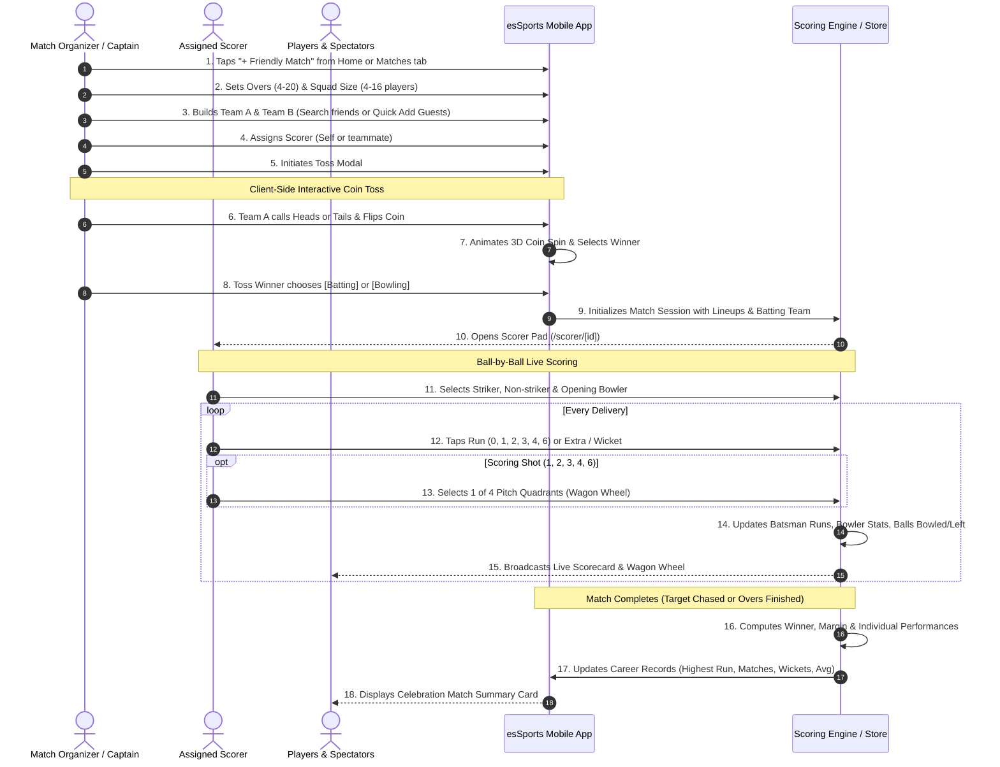

# Friendly Match Engine & Career Statistics Specification

## 1. Executive Summary & Purpose

This document outlines the full architectural design, user journeys, data contracts, and implementation roadmap for the **Friendly Match (Quick / Pick-Up Match) Engine** in `esSports`.

While the Tournament feature caters to scheduled multi-team tournaments, the **Friendly Match** feature empowers grassroots cricketers (local friends, district players, gully teams) to launch, toss, score, and track a match in under 60 seconds without creating a formal tournament.

### Key Value Pillars
1. **Zero-Overhead Setup:** Pick two teams, select format (4 to 16 players per side, including bench), and start immediately.
2. **Dual-Entry Squad Building:** Uses the established pattern—search registered `esSports` friends OR quick-add guest players by Name + Phone.
3. **Dedicated Scorer Role:** Creator or an assigned player is granted live scorecard writing permissions.
4. **Interactive Client-Side Toss:** Visual Heads/Tails coin flip determining batting or bowling choice.
5. **Ball-by-Ball Live Scoring with 4-Zone Pitch Wagon:** Leverages our existing scoring engine (`src/features/scoring`) with batsman strike rate, bowler figures, balls bowled/remaining, and 4-quadrant shot placement tracking.
6. **Career Record Aggregation:** Completed friendly matches automatically update players' **Highest Run**, **Total Matches**, **Total Wickets**, and **Batting Average**, feeding the Player Profile.

---

## 2. System Architecture & Data Models

### 2.1 Friendly Match Configuration & State Model
Located in `src/features/match/types.ts` and `src/features/scoring/types.ts`:

```typescript
import type { AvatarTone } from '@/theme';
import type { SquadPlayer } from '@/features/team/types';

export type TossCall = 'heads' | 'tails';
export type TossDecision = 'bat' | 'bowl';

export type FriendlyTossResult = {
  calledByTeamId: string;
  call: TossCall;
  winnerTeamId: string;
  decision: TossDecision;
  tossedAt: string;
};

export type PitchQuadrant = 'off_side' | 'straight_v' | 'leg_side' | 'behind_square';

export type FriendlyTeamSquad = {
  id: string;
  name: string;
  short: string;
  tone: AvatarTone;
  players: SquadPlayer[]; // 4 to 16 players
};

export type FriendlyMatchSetup = {
  id: string;
  matchType: 'friendly';
  overs: number;               // 4, 6, 8, 10, 12, 15, 20
  playersPerSide: number;      // Min 4, Max 16
  teamA: FriendlyTeamSquad;
  teamB: FriendlyTeamSquad;
  assignedScorerId: string;    // User ID authorized to enter scores
  toss: FriendlyTossResult | null;
  status: 'draft' | 'tossed' | 'live' | 'completed';
  createdAt: string;
};
```

### 2.2 4-Quadrant Pitch Wagon Contract
Located in `src/features/match/components/wagon-geometry.ts`:

```typescript
export type ShotQuadrantData = {
  quadrant: PitchQuadrant;
  label: string;               // 'Off Side (Covers/Point)', 'Straight / V', 'Leg Side (Midwicket)', 'Behind (Fine Leg/Third Man)'
  runs: number;
  deliveryNumber: number;
  strikerId: string;
};
```

### 2.3 Career Record Aggregation Contract
Located in `src/features/team/types.ts` and `src/features/profile/types.ts`:

```typescript
export type PlayerMatchPerformance = {
  playerId: string;
  playerName: string;
  runs: number;
  ballsFaced: number;
  fours: number;
  sixes: number;
  isNotOut: boolean;
  oversBowled: number;
  runsConceded: number;
  wicketsTaken: number;
  maidens: number;
};

export type PlayerCareerStatsUpdate = {
  highestRun: string;          // e.g. "86*" or "74"
  totalMatches: number;        // incremented by 1
  totalWickets: number;        // previous + match wickets
  avg: string;                 // total career runs / total dismissals
};
```

---

## 3. End-to-End User Flow



---

## 4. UI & Screen Specifications

### 4.1 Screen 1: Friendly Match Setup (`/match/friendly/setup`)
* **Route:** `src/app/match/friendly/setup.tsx`
* **Components:**
  * **Header:** Title "Friendly Match Setup", Close button, Progress step indicator.
  * **Format Selector:** Overs pill selector (4, 6, 8, 10, 12, 15, 20 overs) + Players per side stepper (Min 4, Max 16).
  * **Team A & Team B Cards:**
    * Team Name input & Tone color pill picker.
    * Lineup list with avatar discs.
    * "Add Player" button opening dual-entry sheet (App Search vs Quick Add Guest by Name/Phone).
  * **Scorer Assignment Row:** Selector designating who can enter scores (defaults to signed-in user).
  * **Footer Action:** Prominent button `"Proceed to Toss"`.

### 4.2 Screen 2: Interactive Toss Modal (`TossCoinModal`)
* **Component:** `src/features/match/components/toss-coin-modal.tsx`
* **Features:**
  * Animated coin displaying gold Head (Crown/Cricket Ball) and silver Tail (Stumps/Bat).
  * Call toggle: `[ Heads ]` or `[ Tails ]` selected by calling captain.
  * `"Flip Coin"` button triggering smooth rotational physics animation.
  * Winner banner: *"Karnaphuli Kings won the toss!"*
  * Choice buttons: `[ Bat First ]` and `[ Bowl First ]`.
  * `"Start Scoring"` button navigating to Scorer Pad.

### 4.3 Screen 3: Scorer Pad Integration (`/scorer/[id]/pad`)
* **Route:** Connected to existing `src/features/scoring/pad-screen.tsx`
* **Features:**
  * **Opening Setup:** Prompts for Opening Striker, Non-striker, and Bowler.
  * **Live Crease Summary:** Live runs, balls faced, strike rate, 4s, 6s for striker and non-striker.
  * **Bowler Summary:** Overs, maidens, runs, wickets, economy.
  * **Over Progress Bar:** Current over deliveries (e.g. `1 · 4 · Wd · 0 · W · 2`), total balls bowled and remaining in innings.
  * **4-Quadrant Shot Wagon Bar:**
    * On legal runs/boundaries, displays a 4-zone picker:
      1. `Off Side` (Covers / Point)
      2. `Straight / V` (Mid Off / Mid On / Long Off)
      3. `Leg Side` (Midwicket / Square Leg)
      4. `Behind / Third Man` (Fine Leg / Third Man)
    * Fast 1-tap logging stored with delivery angle.

### 4.4 Screen 4: Friendly Match Result & Career Update
* **Component:** `src/features/match/components/match-result-summary-card.tsx`
* **Features:**
  * Victory headline: *"Chattogram Strikers won by 14 runs"*
  * Top Performers: Best Batsman & Best Bowler.
  * **Career Stat Rollup Trigger:**
    * Automatically updates player profiles:
      * `highestRun = max(previousHighest, matchScore)`
      * `totalMatches += 1`
      * `totalWickets += matchWickets`
      * `avg = recalculated`

---

## 5. Architectural Quality & FSD Structure

```
src/
├── app/
│   └── match/
│       └── friendly/
│           └── setup.tsx              # Route exporting FriendlyMatchSetupScreen
├── features/
│   ├── match/
│   │   ├── components/
│   │   │   ├── toss-coin-modal.tsx    # Interactive 3D/animated coin flip & decision
│   │   │   ├── pitch-quadrant-bar.tsx # 4-Zone shot direction selector
│   │   │   └── friendly-setup-form.tsx# Match setup inputs (overs, teams, scorer)
│   │   └── types.ts                   # Extended match & toss types
│   ├── scoring/
│   │   ├── engine/
│   │   │   └── career-stats-rollup.ts # Computes Highest Run, Matches, Wickets, Avg
│   │   └── pad-screen.tsx             # Integrates 4-zone shot selection
│   └── team/
│       └── components/
│           └── player-detail-sheet.tsx# Displays updated career records
```

### Quality Constraints:
- Every code file strictly `<= 200 lines` (hard ceiling `270 lines`).
- Zero-crash rendering: all text strictly inside `<Text>`, defensive access (`?.`), and guarded style math.
- Strict TypeScript with zero `any` or `@ts-ignore`.

---

## 6. Phased Implementation Roadmap

### Phase 1: Friendly Match Setup & Dual-Squad Entry
- [x] Create `FriendlyMatchSetupScreen` at `src/app/match/friendly/setup.tsx`.
- [x] Add Overs picker (4 to 20) and Players per side selector (4 to 16).
- [x] Build Team A & Team B squad selection reusing the dual-entry pattern (Registered App Search + Quick Guest Add).
- [x] Implement Scorer Assignment selector.

### Phase 2: Client-Side Interactive Coin Toss
- [x] Build `TossCoinModal` with animated Heads/Tails coin rotation.
- [x] Implement call selection (Heads/Tails) and random physics outcome.
- [x] Add Bat/Bowl choice buttons and persist toss result to match session state.

### Phase 3: Scorer Pad Bridge & 4-Quadrant Pitch Shot Tracker
- [x] Connect Toss outcome to initialize the match in `src/features/scoring`.
- [x] Build `PitchQuadrantBar` (Off Side, Straight V, Leg Side, Behind) into scoring pad.
- [x] Store quadrant shot data with each delivery in the scoring reducer.
- [x] Connect shot quadrant data to the spectator `WagonWheel` component. *(match wagon screen and the friendly result screen show the four-zone split; spectator screens still read sample data)*

### Phase 4: Match Completion & Career Record Aggregator
- [x] Build `career-stats-rollup.ts` to compute Highest Run, Total Matches, Total Wickets, and Avg from completed scorecards.
- [x] Wire updated career statistics into player profile data stores. *(on-device career ledger merged into the profile; server view added in a migration, not yet read by the app)*
- [x] Display celebratory Match Result Summary Card with MVP and stat highlights.

### Phase 5: Verification, Quality Gates & Supabase Preparedness
- [x] Automated unit test suites for setup validation, coin toss logic, 4-zone shot mapping, and career stats calculations.
- [x] Execute `npx tsc --noEmit` (0 errors) and `npx expo lint` (0 warnings).
- [x] Ensure match payload schema matches `supabase/migrations/20261029000000_matches.sql` for cloud integration.

