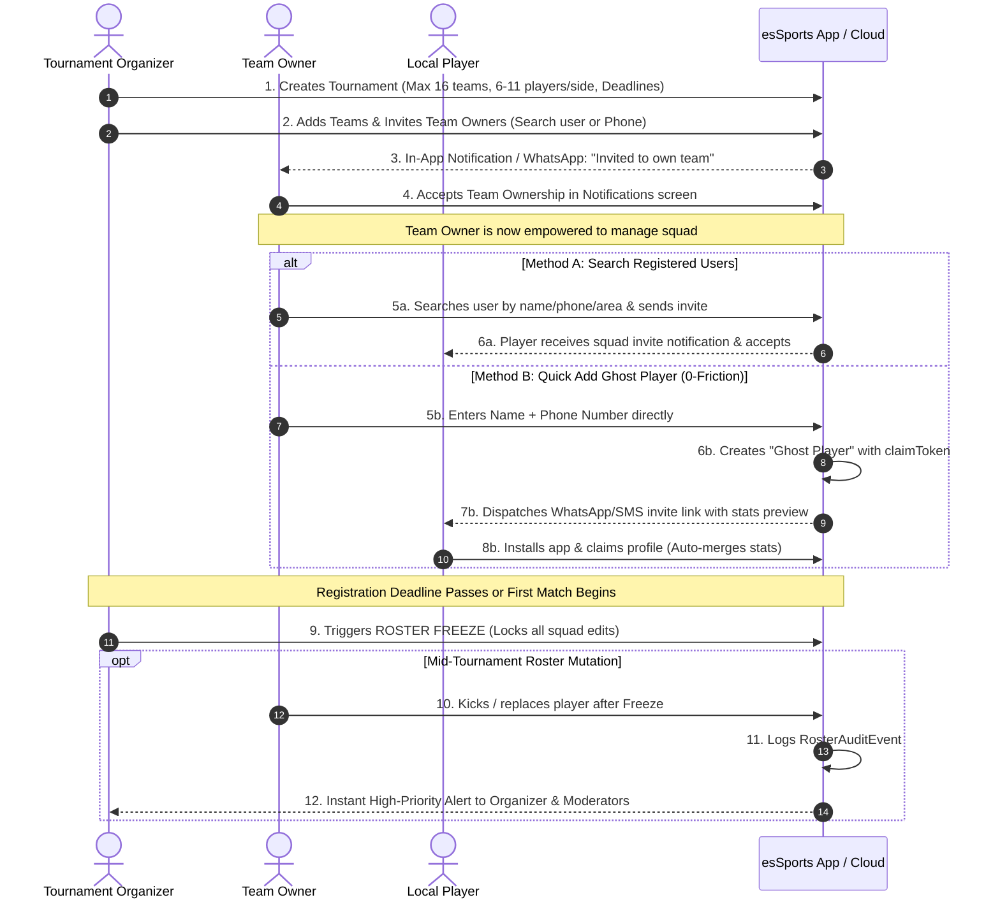

# Tournament-to-Squad Lifecycle & Roster Governance Workflow

## 1. Executive Summary & Vision

This document outlines the complete architectural design and implementation roadmap for the **Tournament-to-Squad Lifecycle** in `esSports`.

The system balances three essential pillars:
1. **Administrative Delegation:** Relieves the Tournament Organizer by delegating squad construction and management to individual Team Owners.
2. **Grassroots Realism (Gully to District Cricket):** Local matches are rarely strictly 11-a-side. The system accommodates flexible game formats (6v6 to 11v11) and dynamic squad sizes (8 to 16 players) with adjustable registration windows.
3. **Viral Adoption via Progressive Profile Claiming:** Eliminates match-day blockers by allowing Team Owners to add players via app search or as temporary "Guest / Ghost" players (Name + Phone). An automatic WhatsApp/SMS deep link invites players to claim their career statistics when they install the app.
4. **Competitive Integrity & Anti-Ringer ("Khyapa") Guard:** Enforces a **Roster Freeze** once the tournament begins. If a Team Owner removes or replaces a player mid-tournament, automated high-priority notifications are dispatched to the Tournament Owner and Moderators.

---

## 2. Core System Architecture & Data Models

### 2.1 Tournament Registration & Format Configuration
Located in `src/features/tournament/create` and `src/features/tournament/roster`:

```typescript
export type MatchFormat = 'gully_6' | 'tapeball_8' | 'local_10' | 'standard_11' | 'custom';

export type TournamentGovernance = {
  maxTeams: number;               // Up to 16 teams
  format: MatchFormat;            // e.g. 6v6, 8v8, 11v11
  playersPerSide: number;         // 6 to 11
  minSquadSize: number;           // e.g. 8
  maxSquadSize: number;           // e.g. 16
  registrationStartDate: string;  // ISO timestamp
  registrationDeadline: string;   // ISO timestamp (extendable by Organizer)
  isRegistrationOpen: boolean;    // Manual or scheduled open/close
  rosterFrozen: boolean;          // Triggered on match 1 or manual freeze
};
```

### 2.2 Dual-Channel Player Roster Model
Located in `src/features/team/types.ts` and `src/features/tournament/roster/types.ts`:

```typescript
export type PlayerRegistrationType = 'registered' | 'ghost';
export type ClaimStatus = 'claimed' | 'pending_claim' | 'unclaimed';

export type TournamentPlayer = {
  id: string;                     // UUID for registered or synthetic ID for ghost
  name: string;
  phone?: string;                 // Required for ghost player claiming
  userId?: string | null;         // Linked user UUID once claimed
  type: PlayerRegistrationType;
  claimStatus: ClaimStatus;
  claimToken?: string;            // Secure token for viral claim deep link
  role: string;                   // Batter, Bowler, All-rounder, Keeper
  tag?: 'C' | 'WK';               // Captain or Wicketkeeper
  addedAt: string;                // Timestamp
  addedDuringTournament: boolean; // Flagged if added post-freeze
};
```

### 2.3 Mid-Tournament Audit & Notification Event
Located in `src/features/tournament/roster/types.ts`:

```typescript
export type RosterChangeAction = 'player_added' | 'player_removed' | 'owner_changed';

export type RosterAuditEvent = {
  id: string;
  tournamentId: string;
  teamId: string;
  teamName: string;
  action: RosterChangeAction;
  targetPlayerName: string;
  performedByUserId: string;
  reason?: string;
  timestamp: string;
  notifiedRole: ('owner' | 'moderator')[];
  requiresApproval?: boolean;
};
```

---

## 3. End-to-End User Journeys



---

## 4. Detailed Functional Specifications

### 4.1 Step 1: Tournament Setup & Registration Window
* **Path:** `src/features/tournament/create`
* **Features:**
  * **Team Capacity:** Configurable slider or segmented control (4, 8, 12, 16 teams).
  * **Format Flexibility:**
    * *Short-Pitch / Gully:* 6 or 7 players per side (Squad: 8–10).
    * *Tape-ball League:* 8, 9, or 10 players per side (Squad: 10–12).
    * *District Tournament:* 11 players per side (Squad: 14–16).
  * **Registration Lifecycle Controller:**
    * Start Date & Application Deadline.
    * Real-time Organizer overrides: **"Extend Deadline"**, **"Close Registrations Now"**, and **"Re-open Applications"**.

### 4.2 Step 2: Team Roster & Team Owner Invitation
* **Path:** `src/features/tournament/roster/add-teams-screen.tsx`
* **Features:**
  * Organizer adds teams (up to 16) with names, short codes, and colors/logos.
  * For each team, assigns an Owner Slot:
    * Search user in database via [user-search-sheet.tsx](file:///c:/office-work/esSports/src/features/tournament/roster/components/user-search-sheet.tsx).
    * If unregistered, invite via phone number/WhatsApp link.
  * Status badges: `Invite Pending`, `Accepted`, `Vacant`.

### 4.3 Step 3: Team Owner Dashboard & Squad Building
* **Path:** `src/features/team/team-squad-screen.tsx` & `src/features/invitations`
* **Features:**
  * Team Owner receives incoming invitation in [invitations-screen.tsx](file:///c:/office-work/esSports/src/features/invitations/invitations-screen.tsx).
  * Tapping **"Accept Ownership"** unlocks the Squad Management Dashboard for that team.
  * **Dual-Mode Player Addition:**
    1. **Search App Users:** Auto-suggests registered local players in their district.
    2. **Quick Add / Ghost Player:** Form requiring only `Player Name`, `Role`, and optional `Phone Number`. Squad is immediately filled without blocking game commencement.
  * **Viral Share Link:**
    * Generates unique link: `https://essports.app/claim?token=XYZ&team=HalishaharStrikers`.
    * One-tap share to WhatsApp, Messenger, or SMS:
      > *"Tanvir added you to Halishahar Strikers squad for HSF Premier League! Check match updates and claim your player profile: [Link]"*

### 4.4 Step 4: Roster Freeze Engine
* **Path:** `src/features/tournament/roster/permissions.ts`
* **Logic:**
  * Transition from `registration_open` to `roster_frozen`.
  * Triggered automatically when the first match scorecard is initialized or manually by the Tournament Organizer.
  * UI reflects a **"Roster Locked"** security badge on all team screens.

### 4.5 Step 5: Anti-Khyapa / Mid-Tournament Kick Alerts
* **Path:** `src/features/notifications` & `src/features/tournament/roster`
* **Logic:**
  * If a Team Owner removes a player while `rosterFrozen === true`:
    1. System presents a confirmation dialog warning that Tournament Officials will be alerted.
    2. Dispatches an automated push notification & alert card to the Tournament Owner and all Tournament Moderators:
       > *"⚠️ Squad Alert: Halishahar Strikers removed Liton Roy during active tournament. Reason: Injury / Tactical replacement."*
    3. Action is recorded in the Tournament Audit Trail accessible from the Organizer Desk.

---

## 5. Phased Implementation Roadmap

### Phase 1: Registration Window & Dynamic Format Controls
- [x] Extend Tournament Creation schema with `playersPerSide`, `minSquadSize`, `maxSquadSize`, and registration dates.
- [x] Implement Organizer controls to extend/shorten registration windows.
- [x] Add format presets: Gully (6–8), Tape-ball (8–10), District (11v11).

### Phase 2: Team Roster Expansion & Team Owner Notifications
- [x] Support up to 16 teams with distinct team owner slots in [roster-repository.ts](file:///c:/office-work/esSports/src/features/tournament/roster/roster-repository.ts).
- [x] Implement in-app notification and WhatsApp/SMS link generation for Team Owner invitations. _(Share-sheet link; inviting an owner with no account by phone is not done yet.)_
- [x] Wire Team Owner acceptance transition in [invitations-screen.tsx](file:///c:/office-work/esSports/src/features/invitations/invitations-screen.tsx).

### Phase 3: Team Owner Squad Builder & Viral Ghost Claiming
- [x] Build dual player entry sheet: Registered User Search vs Quick Ghost Add (Name + Phone).
- [x] Create deep link routing (`/claim/[token]`) for players to claim ghost profiles and merge match statistics upon registration. _(Stats merge is server-side, pending Supabase.)_
- [x] Implement WhatsApp/SMS share sheet helper for squad invites.

### Phase 4: Roster Freeze Engine & Moderator Kick Alerting
- [ ] Implement `rosterFrozen` state triggered on tournament match commencement. _(Manual "Lock rosters" done; automatic trigger on first scorecard pending.)_
- [x] Add warning confirmation modal on mid-tournament player removals.
- [x] Implement automated alert dispatch to Tournament Owner and Moderators when players are dropped or substituted post-freeze. _(In-app Squad alerts on the organiser desk; push delivery pending backend.)_

### Phase 5: Verification, Testing & Low-End Device Optimization
- [x] Unit & integration test suites for registration windows, invitations, ghost claims, and freeze guards.
- [x] Strict typecheck (`npx tsc --noEmit`) and zero-warning lint (`npx expo lint`).
- [ ] Verify offline-first resiliency and smooth performance on low-bandwidth networks.
